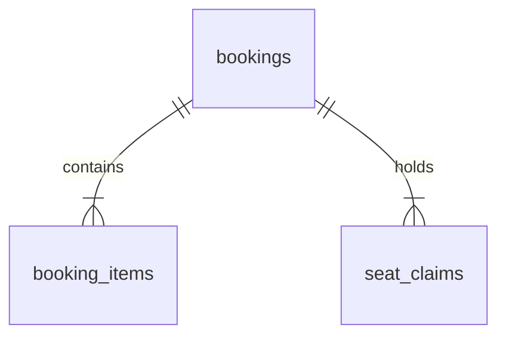

# Booking Service (Thành viên 3)

## Phạm vi sở hữu

Booking Service sở hữu **trạng thái ghế theo suất chiếu** và database `cinema_booking_db`.
Movie Service sở hữu suất chiếu/cấu trúc ghế/giá; Payment Service sở hữu giao dịch thanh toán.
Booking không ghi trực tiếp sang database của các service khác.

## ERD thu gọn

- `bookings`: đơn, userId, showtimeId, ảnh chụp thông tin phim/rạp/phòng, tiền, trạng thái, thời hạn, mã vé và dữ liệu thanh toán.
- `booking_items`: từng ghế cùng giá tại thời điểm giữ.
- `seat_claims`: từng quyền giữ hoặc bán ghế. Bắt buộc `UNIQUE(showtime_id, seat_id)`.

## Quy trình giữ ghế

1. Xác thực JWT ở Gateway, đưa `X-User-Id` xuống Booking.
2. Booking gọi Movie Service để kiểm tra suất chiếu và ghế; tính tổng tiền từ giá trả về bởi Movie.
3. Dọn các đơn giữ ghế đã hết hạn cho suất đó.
4. Trong một transaction MySQL: tạo `bookings`, `booking_items`, `seat_claims`.
5. Nếu một ghế trùng ràng buộc UNIQUE, rollback toàn bộ và trả HTTP 409.

Đừng chỉ dựa vào ghế trống hiển thị ở Frontend: hai request có thể cùng quan sát ghế trống.

## Trạng thái

`PENDING_PAYMENT` -> `CONFIRMED` khi Payment SUCCESS.

`PENDING_PAYMENT` -> `CANCELLED` khi hủy hoặc Payment FAILED.

`PENDING_PAYMENT` -> `EXPIRED` khi quá thời hạn mà chưa bắt đầu thanh toán.

Ghế `HELD` chuyển `SOLD` khi xác nhận; khi hủy/hết hạn, xóa `seat_claims` đang HELD.

## An toàn khi thanh toán

Không giữ khóa MySQL khi gọi HTTP tới Payment Service.
Booking ghi một khoảng thuê xử lý (lease) `payment_processing_until` trong transaction ngắn,
sau đó gọi Payment. Kết quả trả về phải trùng `bookingId`, số tiền, phương thức.
Khi hoàn tất, Booking khóa lại đơn, kiểm tra lease rồi mới xác nhận/hủy.

Giao dịch có phản hồi không rõ được giữ lại và job thử lại với **cùng `bookingId`**.
TV4 phải bảo đảm Payment Service chống ghi trùng theo `bookingId`; hai service không có transaction chung.

## Giới hạn và điểm cần phối hợp

- Chưa thể demo thanh toán end-to-end cho đến khi TV4 hoàn thiện Payment Service.
- Gateway/User Service hiện có thể chưa hoàn chỉnh; gọi trực tiếp 8083 chỉ dùng để kiểm thử local.
- Ở hệ thống triển khai thật, không công khai 8083 hoặc tin header `X-User-*` từ Internet.
- SQL schema trong `database/` dùng cho môi trường demo; khi dữ liệu đã có, nên quản lý migration rõ ràng.
- Tránh chỉnh/sửa suất chiếu đã có booking ở Movie Service mà không kiểm tra quyền đặt hiện tại.
