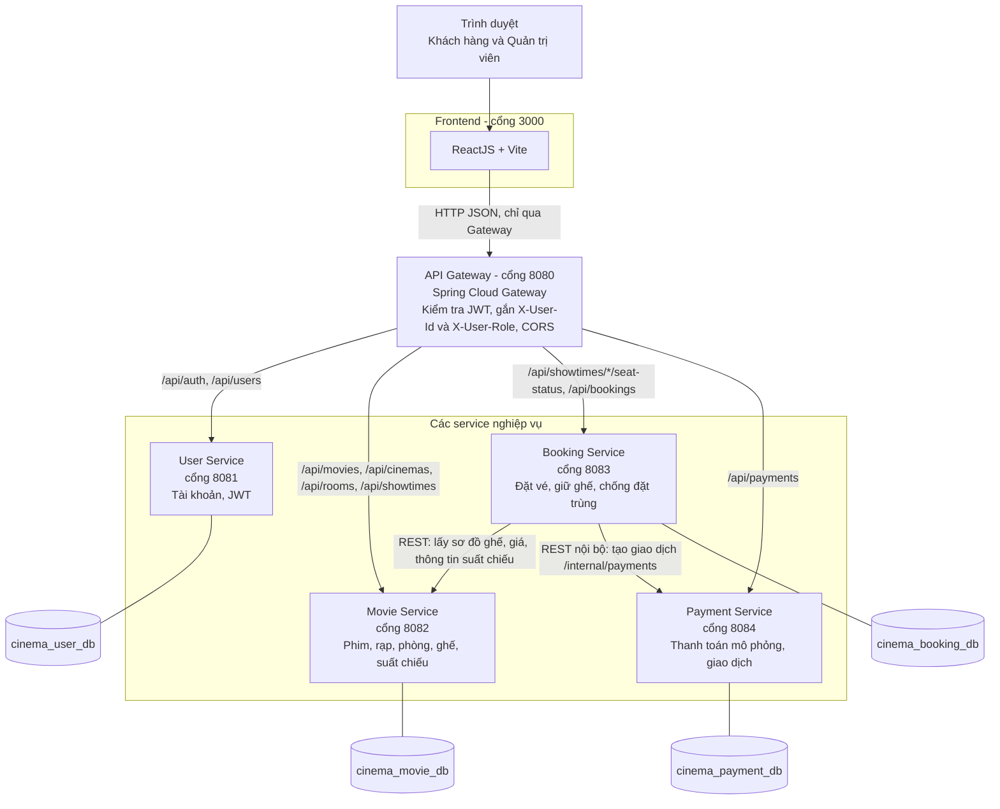
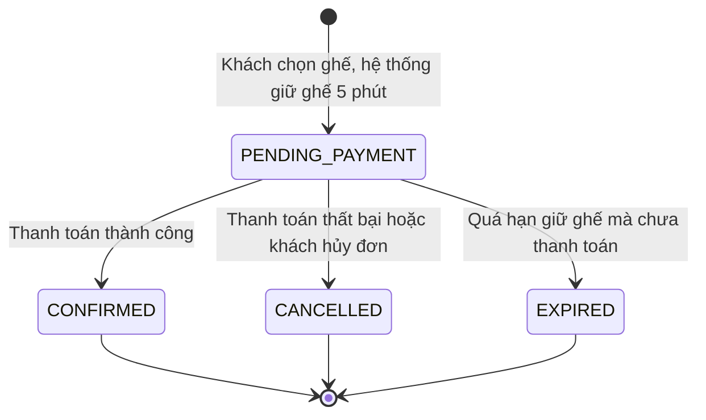
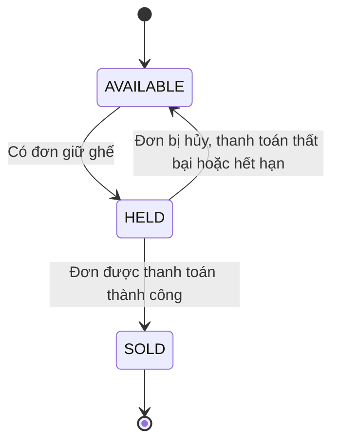

# Sơ đồ kiến trúc SOA

Hệ thống gồm 4 service độc lập, một API Gateway và một Frontend. Mỗi service sở hữu database riêng và chỉ giao tiếp với service khác qua REST API.

## 1. Kiến trúc tổng thể

## 2. Vai trò từng thành phần

| Thành phần | Công nghệ | Trách nhiệm | Dữ liệu sở hữu |
|---|---|---|---|
| Frontend | ReactJS, Vite | Giao diện khách hàng và quản trị, ghép sơ đồ ghế | Không có |
| API Gateway | Spring Cloud Gateway | Định tuyến, kiểm tra JWT, gắn header danh tính, chặn `/internal/**`, CORS | Không có |
| User Service | Spring Boot, Spring Security | Đăng ký, đăng nhập, phát hành JWT, phân quyền CUSTOMER và ADMIN | Người dùng |
| Movie Service | Spring Boot, JPA | Phim, rạp, phòng chiếu, ghế vật lý, suất chiếu, giá ghế | Phim, rạp, phòng, ghế, suất chiếu |
| Booking Service | Spring Boot, JPA | Tạo đơn, giữ ghế 5 phút, chống đặt trùng, tự hủy khi hết hạn, **sở hữu trạng thái ghế** | Đơn đặt vé, ghế đang giữ hoặc đã bán |
| Payment Service | Spring Boot, JPA | Xử lý thanh toán mô phỏng, lưu giao dịch, chống thanh toán lặp | Giao dịch thanh toán |

## 3. Giao tiếp giữa các thành phần

| Từ | Đến | Cách gọi | Mục đích |
|---|---|---|---|
| Frontend | Gateway | `/api/...`, kèm `Authorization: Bearer <token>` | Mọi yêu cầu của người dùng |
| Gateway | 4 service | Định tuyến theo đường dẫn | Chuyển request, gắn `X-User-Id`, `X-User-Role` |
| Booking Service | Movie Service | `GET /api/showtimes/{id}/seats`, `GET /api/showtimes/{id}` | Kiểm tra ghế hợp lệ, lấy giá, tính tổng tiền, lưu thông tin phim vào đơn |
| Booking Service | Payment Service | `POST /internal/payments` (đồng bộ) | Tạo giao dịch thanh toán và nhận kết quả ngay |
| Frontend | Booking Service | `GET /api/showtimes/{id}/seat-status` | Trạng thái ghế, ghép với sơ đồ ghế từ Movie Service |

Frontend **không** gọi Payment Service trực tiếp. Frontend gọi `POST /api/bookings/{id}/pay`, Booking Service tự gọi Payment Service rồi trả kết quả.

## 4. Nguyên tắc thiết kế

| Nguyên tắc | Cách thực hiện |
|---|---|
| Database riêng cho mỗi service | 4 database MySQL, không service nào truy cập database của service khác, chỉ gọi API |
| Xác thực tập trung tại Gateway | Gateway kiểm tra chữ ký và hạn của JWT, các service chỉ đọc header `X-User-Id`, `X-User-Role` |
| Chống giả mạo danh tính | Gateway luôn xóa `X-User-Id`, `X-User-Role` do client tự gửi trước khi gắn giá trị thật |
| API nội bộ không lộ ra ngoài | Đường dẫn `/internal/**` không có route nên Gateway trả 404 |
| Booking Service là chủ trạng thái ghế | Movie Service chỉ có cấu trúc ghế, Booking Service quyết định ghế trống, đang giữ hay đã bán |
| Không có transaction chung giữa Booking và Payment | Dùng Saga đơn giản do Booking Service điều phối: giữ ghế, thanh toán, xác nhận. Nếu thất bại hoặc hết hạn thì thực hiện hành động bù là giải phóng ghế |
| Chống xử lý lặp | Thanh toán lặp trên đơn đã thành công trả lại kết quả cũ, không tạo giao dịch mới |

## 5. Vòng đời đơn đặt vé

## 6. Trạng thái của một ghế trong một suất chiếu

Ghế `AVAILABLE` không được lưu, chỉ có ghế `HELD` và `SOLD` xuất hiện trong `GET /api/showtimes/{id}/seat-status`.