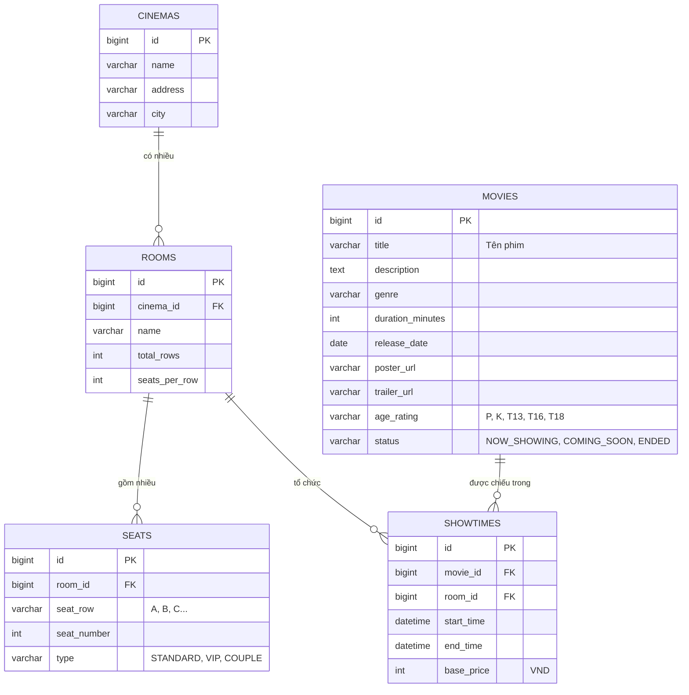

# ERD của Movie Service

Database `cinema_movie_db` gồm 5 bảng, do Hibernate tự tạo từ các entity (`ddl-auto: update`).

## 1. Sơ đồ ERD

## 2. Mô tả các bảng

| Bảng | Ý nghĩa | Ghi chú |
|---|---|---|
| `movies` | Phim | `status` quyết định phim hiện ở mục Đang chiếu, Sắp chiếu hay Ngừng chiếu |
| `cinemas` | Rạp chiếu | Một rạp có nhiều phòng |
| `rooms` | Phòng chiếu | `total_rows` x `seats_per_row` là kích thước, ghế được **tự sinh** khi tạo phòng |
| `seats` | Ghế vật lý của phòng | Chỉ có cấu trúc và loại ghế, **không có trạng thái giữ hay đã bán** |
| `showtimes` | Suất chiếu | `end_time` do server tính, `base_price` là giá ghế thường |

## 3. Ràng buộc và chỉ mục

| Loại | Nội dung | Mục đích |
|---|---|---|
| Duy nhất | `seats (room_id, seat_row, seat_number)` | Một phòng không thể có hai ghế cùng vị trí |
| Khóa ngoại | `rooms.cinema_id`, `seats.room_id`, `showtimes.movie_id`, `showtimes.room_id` | Toàn vẹn dữ liệu |
| Xóa lan truyền | Xóa rạp xóa các phòng, xóa phòng xóa các ghế | Dữ liệu con không bị mồ côi |
| Chỉ mục | `movies.status`, `movies.title` | Lọc và tìm phim nhanh |
| Chỉ mục | `showtimes.start_time`, `showtimes (room_id, start_time, end_time)` | Lọc theo ngày và phát hiện trùng giờ trong phòng |

Tên cột ghế là `seat_row` và `seat_number` (không phải `row` và `number`) vì `row` là từ khóa của MySQL 8. Khi trả JSON, hệ thống đổi lại thành `row` và `number` theo `api-contract.md`.

## 4. Quy tắc nghiệp vụ gắn với dữ liệu

| Quy tắc | Nơi thực hiện |
|---|---|
| `end_time` = `start_time` + `duration_minutes` của phim + 15 phút dọn phòng | `ShowtimeService` |
| Hai suất trong cùng phòng không được chồng giờ, vi phạm trả 409 | `ShowtimeRepository.countOverlapping` |
| Giờ bắt đầu khi tạo hoặc sửa suất chiếu phải ở tương lai | `ShowtimeService` |
| Giá ghế: thường = giá gốc, VIP = 1,3 lần, đôi = 2 lần, làm tròn xuống đến nghìn | `SeatPricingService` |
| Phòng từ 4 hàng trở lên: hai hàng cuối mặc định là ghế VIP | `RoomService` |
| Không xóa phòng đã có suất chiếu, không xóa rạp có phòng đã có suất chiếu | `RoomService`, `CinemaService` |
| Không xóa phim còn suất chiếu trong tương lai | `MovieService` |

## 5. Liên kết logic với các service khác

Các service khác **không dùng khóa ngoại** tới database của Movie Service, vì mỗi service có database riêng. Chúng chỉ lưu **mã** (ID) và gọi API khi cần dữ liệu.

| Service | Dữ liệu tham chiếu tới Movie Service | Cách lấy chi tiết |
|---|---|---|
| Booking Service | `showtimeId`, `seatIds` của mỗi đơn | `GET /api/showtimes/{id}` và `GET /api/showtimes/{id}/seats` |
| Booking Service | Lưu sẵn bản sao `movieTitle`, `cinemaName`, `roomName`, `startTime` trong đơn | Không cần gọi lại, vé cũ vẫn hiển thị đúng khi phim hoặc suất bị sửa |

Hệ quả đã biết: Movie Service không biết suất chiếu nào đã có người đặt vé nên không chặn được việc xóa suất chiếu đã có vé. Đây là một hạn chế của việc tách database theo service, cách xử lý đầy đủ là Movie Service hỏi Booking Service trước khi xóa.