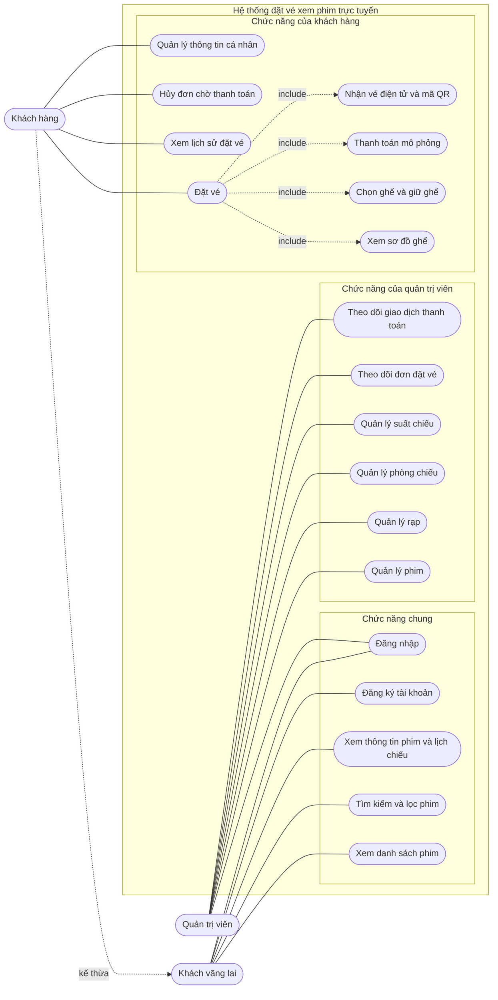

# Use Case Diagram

## 1. Tác nhân

| Tác nhân | Mô tả |
|---|---|
| Khách vãng lai | Người chưa đăng nhập, chỉ xem được phim và lịch chiếu |
| Khách hàng (Customer) | Người đã đăng nhập, **kế thừa** mọi chức năng của khách vãng lai và đặt được vé |
| Quản trị viên (Admin) | Quản lý dữ liệu và theo dõi hoạt động của hệ thống |

## 2. Sơ đồ

Mermaid không có kiểu sơ đồ use case riêng nên sơ đồ dưới đây dùng flowchart: hình tròn dài là tác nhân, hình bầu dục là use case, khung là ranh giới hệ thống, đường đứt là quan hệ `include` hoặc kế thừa.

## 3. Danh sách use case

| Mã | Use case | Tác nhân | API chính |
|---|---|---|---|
| UC1 | Xem danh sách phim | Khách vãng lai | `GET /api/movies` |
| UC2 | Tìm kiếm và lọc phim | Khách vãng lai | `GET /api/movies?keyword=&status=` |
| UC3 | Xem thông tin phim và lịch chiếu | Khách vãng lai | `GET /api/movies/{id}`, `GET /api/showtimes?movieId=` |
| UC4 | Đăng ký tài khoản | Khách vãng lai | `POST /api/auth/register` |
| UC5 | Đăng nhập | Khách vãng lai, Admin | `POST /api/auth/login` |
| UC6 | Đặt vé | Khách hàng | Gồm UC7, UC8, UC9, UC10 |
| UC7 | Xem sơ đồ ghế | Khách hàng | `GET /api/showtimes/{id}/seats`, `.../seat-status` |
| UC8 | Chọn ghế và giữ ghế | Khách hàng | `POST /api/bookings` |
| UC9 | Thanh toán mô phỏng | Khách hàng | `POST /api/bookings/{id}/pay` |
| UC10 | Nhận vé điện tử và mã QR | Khách hàng | `GET /api/bookings/{id}` |
| UC11 | Xem lịch sử đặt vé | Khách hàng | `GET /api/bookings/my` |
| UC12 | Hủy đơn chờ thanh toán | Khách hàng | `POST /api/bookings/{id}/cancel` |
| UC13 | Quản lý thông tin cá nhân | Khách hàng | `GET`, `PUT /api/users/me` |
| UC14 | Quản lý phim | Admin | `POST`, `PUT`, `DELETE /api/movies` |
| UC15 | Quản lý rạp | Admin | `POST`, `PUT`, `DELETE /api/cinemas` |
| UC16 | Quản lý phòng chiếu | Admin | `POST /api/cinemas/{id}/rooms`, `PUT`, `DELETE /api/rooms/{id}` |
| UC17 | Quản lý suất chiếu | Admin | `POST`, `PUT`, `DELETE /api/showtimes` |
| UC18 | Theo dõi đơn đặt vé | Admin | `GET /api/bookings` |
| UC19 | Theo dõi giao dịch thanh toán | Admin | `GET /api/payments` |

## 4. Đặc tả use case chính

### UC6: Đặt vé

| Mục | Nội dung |
|---|---|
| Tác nhân | Khách hàng |
| Điều kiện trước | Đã đăng nhập. Suất chiếu chưa bắt đầu. Còn ghế trống |
| Điều kiện sau (thành công) | Đơn ở trạng thái `CONFIRMED`, ghế chuyển sang đã bán, khách nhận vé có mã QR |
| Điều kiện sau (thất bại) | Đơn ở trạng thái `CANCELLED` hoặc `EXPIRED`, ghế được trả lại |

**Luồng chính:**

1. Khách chọn phim và chọn một suất chiếu.
2. Hệ thống hiển thị sơ đồ ghế (ghế trống, đang giữ, đã bán, VIP, ghế đôi).
3. Khách chọn một hoặc nhiều ghế trống (tối đa 8 ghế) và xem tổng tiền.
4. Khách bấm "Giữ ghế và thanh toán". Hệ thống kiểm tra ghế còn trống, tạo đơn `PENDING_PAYMENT` và giữ ghế trong 5 phút.
5. Khách chọn phương thức thanh toán và xác nhận.
6. Hệ thống tạo giao dịch thanh toán mô phỏng, nhận kết quả thành công.
7. Hệ thống chuyển đơn sang `CONFIRMED`, ghế sang đã bán, phát hành mã vé.
8. Hệ thống hiển thị vé điện tử có mã QR.

**Luồng thay thế:**

| Bước | Tình huống | Xử lý |
|---|---|---|
| 4 | Có ghế vừa bị người khác giữ hoặc mua | Hệ thống trả lỗi 409, giao diện tải lại sơ đồ ghế và yêu cầu khách chọn ghế khác |
| 4 | Khách chưa đăng nhập | Chuyển sang trang đăng nhập, đăng nhập xong quay lại đúng suất chiếu |
| 6 | Thanh toán thất bại | Đơn chuyển `CANCELLED`, ghế được trả lại, khách có thể đặt lại |
| 5 | Quá 5 phút mà chưa thanh toán | Đơn chuyển `EXPIRED`, ghế được trả lại tự động |
| 5 | Khách bấm hủy đơn | Đơn chuyển `CANCELLED`, ghế được trả lại |
| 6 | Khách thanh toán lại đơn đã thành công | Hệ thống trả lại kết quả cũ, không tạo giao dịch mới |

### UC17: Quản lý suất chiếu

| Mục | Nội dung |
|---|---|
| Tác nhân | Admin |
| Điều kiện trước | Đã đăng nhập bằng tài khoản ADMIN. Đã có phim và phòng chiếu |
| Điều kiện sau | Suất chiếu được tạo, sửa hoặc xóa, khách hàng thấy thay đổi ngay trên lịch chiếu |

**Luồng chính (thêm suất chiếu):**

1. Admin mở trang Quản trị, chọn tab Suất chiếu và bấm "Thêm suất chiếu".
2. Admin chọn phim, chọn phòng chiếu, nhập giờ bắt đầu và giá ghế thường.
3. Hệ thống hiển thị giờ kết thúc dự kiến (giờ bắt đầu cộng thời lượng phim cộng 15 phút dọn phòng).
4. Admin bấm Lưu. Hệ thống kiểm tra giờ bắt đầu ở tương lai và phòng không bị trùng giờ, rồi lưu suất chiếu.

**Luồng thay thế:**

| Bước | Tình huống | Xử lý |
|---|---|---|
| 4 | Phòng đã có suất khác chồng khung giờ | Trả lỗi 409, admin chọn giờ hoặc phòng khác |
| 4 | Giờ bắt đầu nằm trong quá khứ | Trả lỗi 400 |
| 1 | Người dùng không phải ADMIN | Giao diện chặn trang quản trị, API trả 403 |