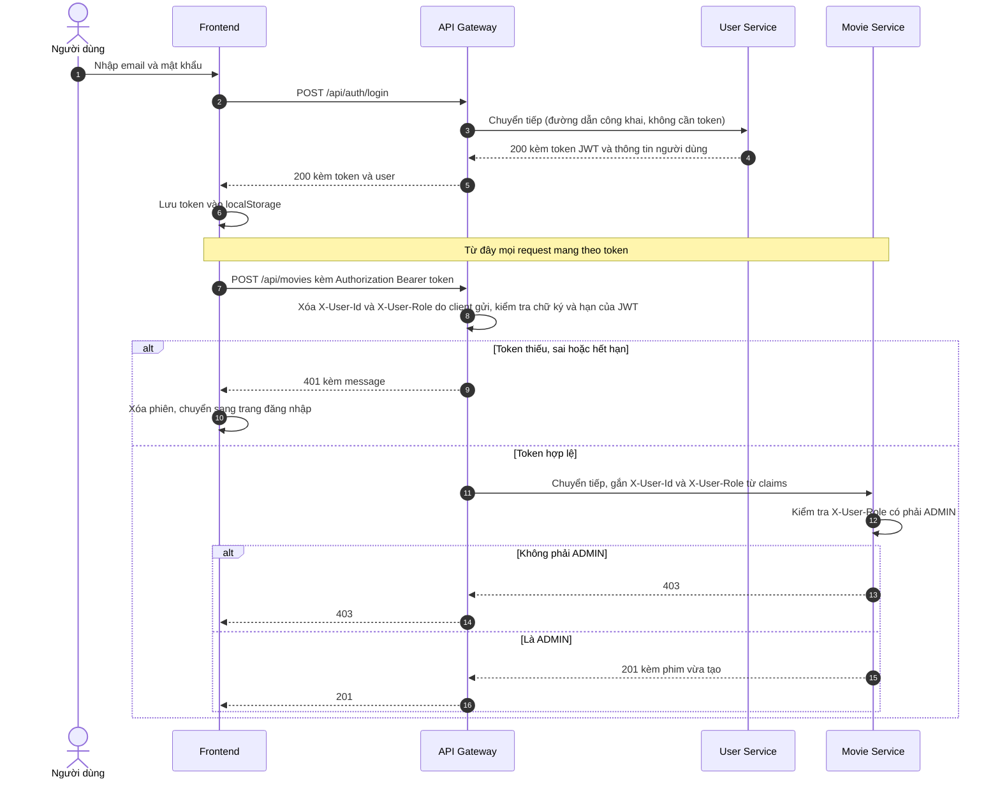
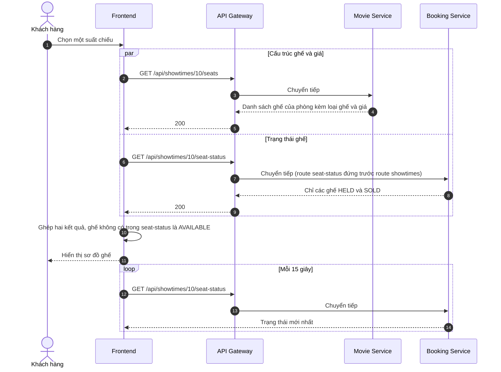
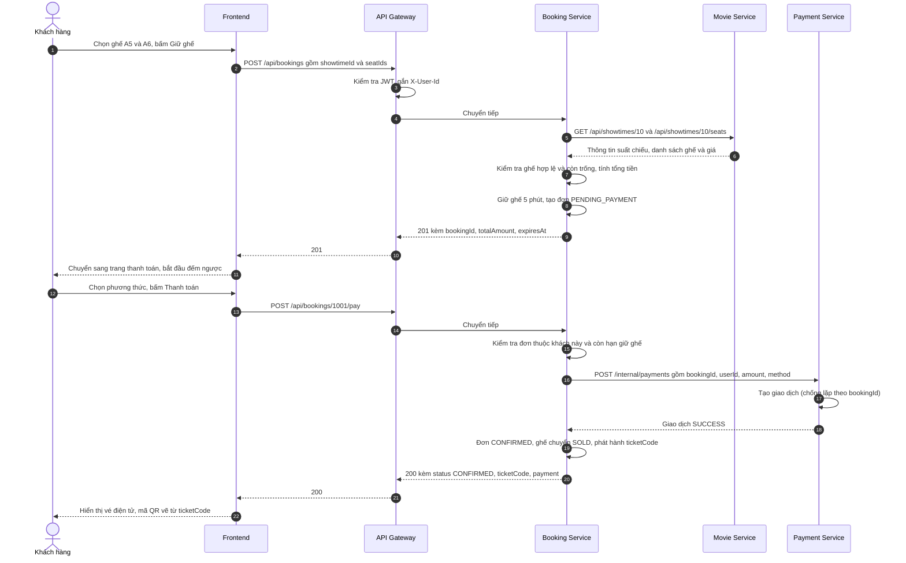
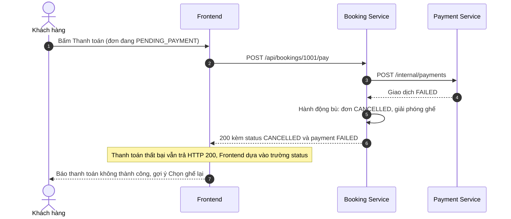
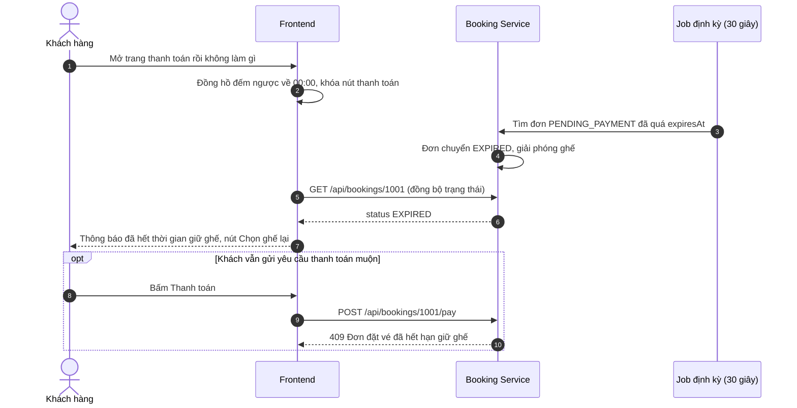
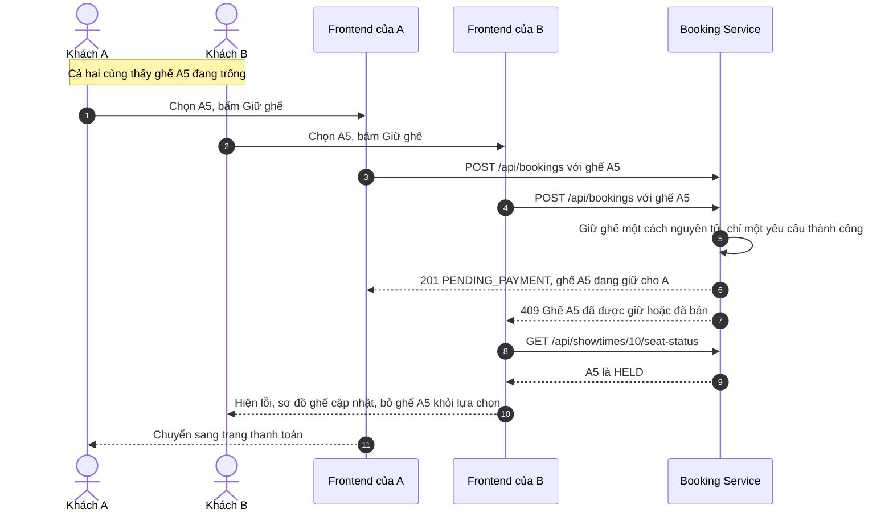
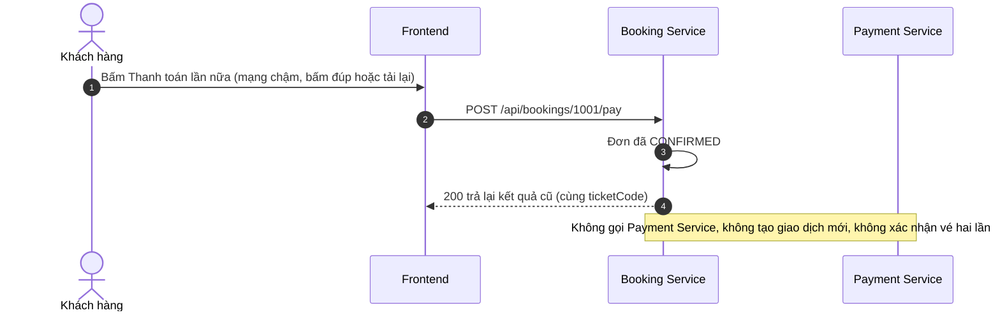
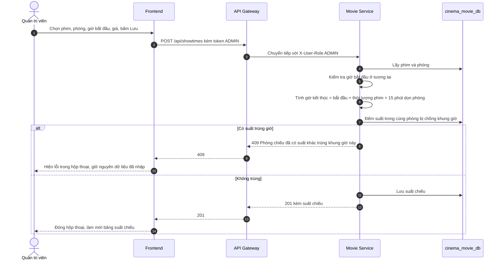

# Sequence Diagram

Các sơ đồ dưới đây bám theo `docs/api-contract.md`. Hai service Booking và Payment do thành viên khác phụ trách, nên các bước bên trong chúng được vẽ ở mức hành vi mà contract yêu cầu.

## 1. Đăng nhập và kiểm tra JWT tại Gateway

## 2. Xem sơ đồ ghế của một suất chiếu

Cấu trúc ghế và giá nằm ở Movie Service, trạng thái ghế nằm ở Booking Service. Frontend gọi song song hai nơi rồi ghép lại.

## 3. Đặt vé và thanh toán thành công

## 4. Thanh toán thất bại (hành động bù)

Booking Service và Payment Service nằm ở hai database khác nhau nên không có transaction chung. Khi thanh toán thất bại, Booking Service thực hiện hành động bù là hủy đơn và giải phóng ghế.

## 5. Hết thời gian giữ ghế

## 6. Hai khách cùng chọn một ghế (chống đặt trùng)

Việc kiểm tra ghế còn trống và giữ ghế phải thực hiện **nguyên tử** ở Booking Service (khóa hoặc ràng buộc duy nhất trong database), để dù hai request đến cùng lúc cũng chỉ một request thắng.

## 7. Thanh toán lặp trên đơn đã thành công

## 8. Admin thêm suất chiếu

