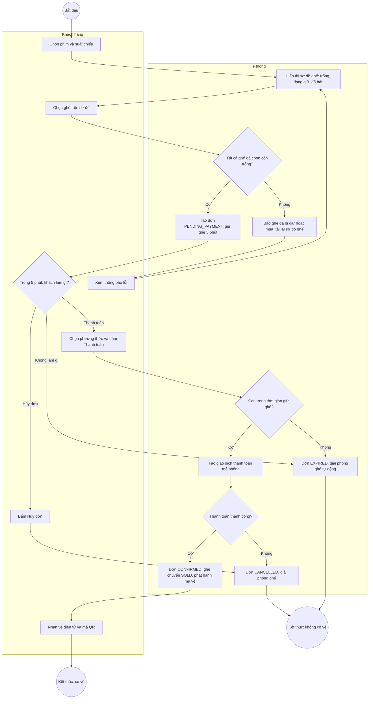
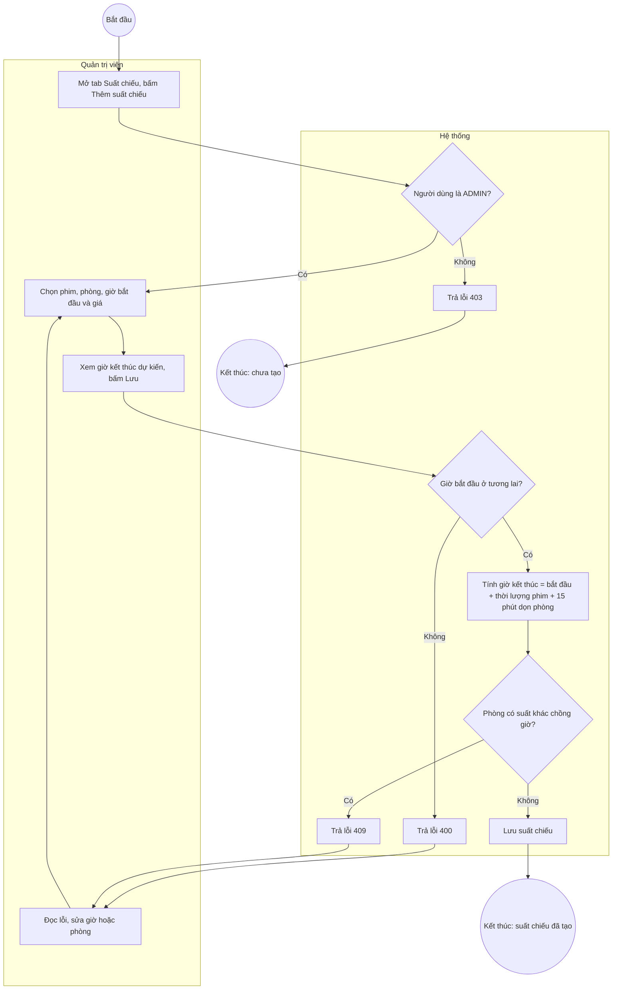

# Activity Diagram

## 1. Quy trình đặt vé và thanh toán

Mermaid không có kiểu Activity Diagram riêng nên sơ đồ dùng flowchart: hai làn (Khách hàng và Hệ thống) là hai khung, hình thoi là điểm rẽ nhánh, vòng tròn là điểm bắt đầu và kết thúc.

## 2. Giải thích các điểm rẽ nhánh

| Điểm rẽ nhánh | Điều kiện | Kết quả |
|---|---|---|
| Ghế còn trống? | Mọi ghế khách chọn đều chưa bị giữ hoặc bán | Có: tạo đơn. Không: trả lỗi 409, khách chọn lại |
| Khách làm gì trong 5 phút | Thanh toán, hủy hoặc bỏ mặc | Ba nhánh khác nhau, đều kết thúc đúng một trạng thái |
| Còn thời gian giữ ghế? | `expiresAt` chưa qua | Không: đơn `EXPIRED`, thanh toán bị từ chối (409) |
| Thanh toán thành công? | Kết quả giao dịch của Payment Service | Có: vé được phát hành. Không: hành động bù, giải phóng ghế |

## 3. Quy trình quản trị: thêm suất chiếu

