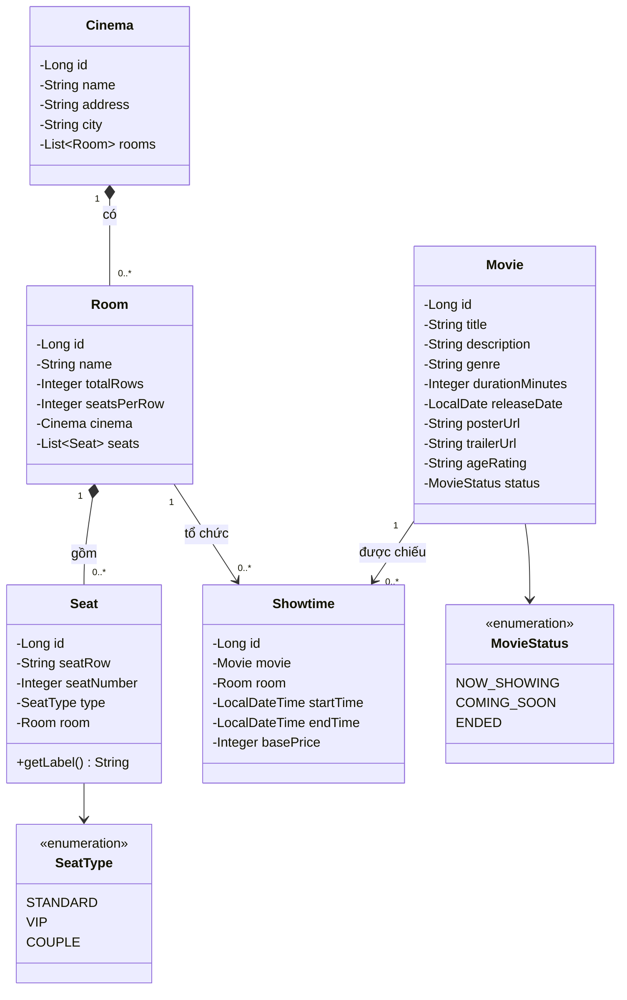
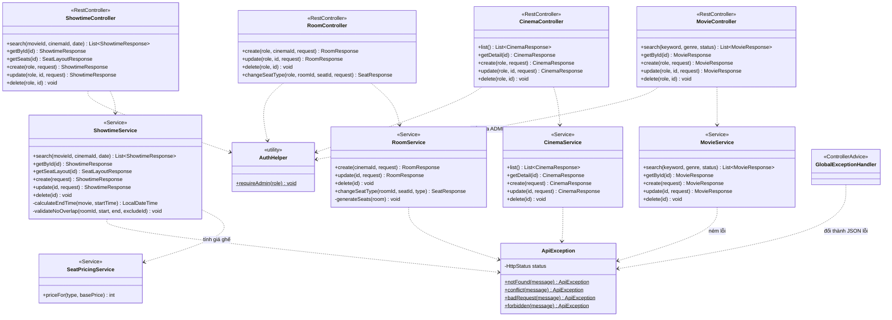
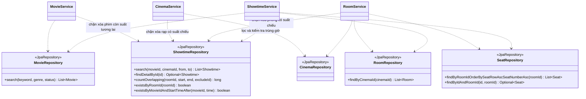

# Class Diagram của Movie Service

Các sơ đồ được vẽ theo mã nguồn trong `services/movie-service/src/main/java/com/cinema/movie/`. Mã chia 3 tầng: Controller nhận request, Service xử lý nghiệp vụ, Repository truy cập database.

## 1. Mô hình thực thể (package `entity`)

Quan hệ thành phần (hình thoi đặc) thể hiện xóa rạp thì xóa các phòng, xóa phòng thì xóa các ghế (`cascade` và `orphanRemoval`).

## 2. Tầng Controller và Service

## 3. Tầng Service và Repository

## 4. DTO (package `dto`)

DTO tách dữ liệu trao đổi qua API khỏi entity, để đặt tên trường theo `api-contract.md` và kiểm tra dữ liệu đầu vào. Tất cả là `record` của Java 17.

| DTO | Loại | Dùng cho | Ghi chú |
|---|---|---|---|
| `MovieRequest` | Request | Thêm, sửa phim | Kiểm tra tên không trống, thời lượng lớn hơn 0 |
| `MovieResponse` | Response | Mọi API phim | Có `from(Movie)` |
| `CinemaRequest` | Request | Thêm, sửa rạp | Tên, địa chỉ, thành phố bắt buộc |
| `CinemaResponse` | Response | Danh sách và chi tiết rạp | `summary()` không kèm phòng, `detail()` kèm phòng |
| `RoomRequest` | Request | Thêm phòng | 1 đến 26 hàng, 1 đến 30 ghế mỗi hàng |
| `RoomUpdateRequest` | Request | Đổi tên phòng | Chỉ có tên |
| `RoomResponse` | Response | Phòng | Có thêm `cinemaId` |
| `ShowtimeRequest` | Request | Thêm, sửa suất chiếu | Không có `endTime`, server tự tính |
| `ShowtimeResponse` | Response | Suất chiếu | Kèm tên phim, rạp, phòng |
| `SeatResponse` | Response | Một ghế | Đổi `seatRow` thành `row`, `seatNumber` thành `number`, `price` chỉ có khi gắn với suất chiếu |
| `SeatLayoutResponse` | Response | `GET /api/showtimes/{id}/seats` | Booking Service cũng gọi |
| `SeatTypeRequest` | Request | Đổi loại ghế | Chỉ có `type` |

## 5. Các lớp hỗ trợ

| Lớp | Package | Vai trò |
|---|---|---|
| `GlobalExceptionHandler` | `exception` | Đổi mọi lỗi thành JSON `timestamp, status, error, message, path` |
| `ApiException` | `exception` | Lỗi nghiệp vụ mang mã HTTP, Service chỉ cần `throw ApiException.notFound(...)` |
| `ErrorResponse` | `exception` | Cấu trúc JSON của lỗi |
| `AuthHelper` | `security` | Đọc header `X-User-Role` do Gateway gắn, ném 403 nếu không phải ADMIN |
| `DataInitializer` | `config` | Nạp dữ liệu mẫu (phim, rạp, phòng, suất chiếu 7 ngày) ở lần chạy đầu |